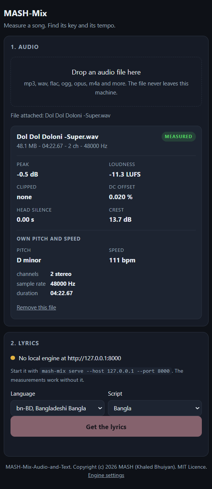

# MASH-Mix-Audio-and-Text, the Chrome extension

The [MASH-Mix-Audio-and-Text](https://github.com/kdbn121/MASH-Mix-Audio-and-Text) engine
as a browser side panel. Drop in a song and the panel measures it: the peak,
the loudness, the clipping, the dc offset, the silence at the head, the crest,
and under **Own pitch and speed** the key of the song and its tempo. With the
local engine running it writes the lyrics as well.

**Nothing you attach leaves your machine.** The measurement happens in the
browser, on your machine. The only thing that is ever sent anywhere is the file
itself, and only when you press **Get the lyrics**, and only to the engine on
your own machine.



## Install

The extension is plain Manifest V3 and it has no build step.

1. Clone or download this repository.
2. Open `chrome://extensions` in Chrome or Edge.
3. Turn on **Developer mode**.
4. Press **Load unpacked** and pick the folder of this repository.
5. Press the MASH-Mix button in the toolbar. The panel opens on the right.

Chrome 114 or newer is needed for the side panel. Edge works the same way.

## What the panel shows

### The file

The name of the file, its size, its length, the number of channels and the
sample rate it was decoded at.

### The measurements

| Measurement | What it means |
|---|---|
| Peak | The loudest sample of the file, in dBFS |
| Loudness | The integrated loudness, in LUFS, measured with the BS.1770 filter on each channel of the file as it is |
| Clipped | The number of samples that reached full scale. Above zero it is a fault the recording cannot repair afterwards |
| DC offset | How far the signal sits above silence, as a percentage of full scale |
| Head silence | The silence at the start of the file, in seconds |
| Crest | The gap between the peak and the average level, in dB |
| Pitch | The key and the mode of the song, for example D minor |
| Speed | The tempo of the song, in beats a minute |

Every number is computed in the browser from the decoded audio.

### The lyrics

With the engine running, the panel also writes the lyrics of the song, with
the timestamps, and offers the subtitle files to download. It can also speak
the lyrics.

## The engine

The lyrics need a little help: a speech model does not fit in a browser
extension. The engine is the Python package of the same project, and it runs
on your machine.

```bash
pip install 'mash-mix-audio-and-text[server]'
mash-mix serve --host 127.0.0.1 --port 8000
```

The panel finds the engine at `http://127.0.0.1:8000` by default. Change the
address in the settings of the extension if you run it on another port. The
measurements work without the engine.

## How the numbers are worked out

The interesting part of this extension is not the panel, it is the analysis
behind it. Two things are worth knowing.

**The key is read from the peaks of the spectrum, not from every bin of it.** A
loud note spreads its energy over the bins around it, and the broadband skirt
of that energy leaks into the pitch classes next door. The harmonic content of
a chord does the same. Count every bin and a C major triad that carries a few
harmonics reads as E minor, and a whole song reads as the wrong key. Count
only the peaks and it reads as C major.

**The beat period is searched in steps of a fraction of a frame.** The beat of
a real track does not land on a whole frame of the analysis grid, and a search
that only looks at whole frames reads the wrong tempo whenever it does not. The
search moves in small steps and folds the onsets onto the beat grid to tell a
beat apart from two beats, so a track that beats at 120 is not reported at 60.

**The frequency of a peak is worked out from the bins around it.** A tone of
220 Hz does not sit on a bin of the transform, it falls between two of them, and
at the bottom of the range a semitone is narrower than a bin. The peak is
therefore fitted with a parabola on the three bins around it, so the key of a
file does not change when the file is at 22050 Hz or at 48000 Hz. Without it a
C major triad read as E minor at 48 kHz.

All three rules are the same ones the Python engine uses, and the two agree on
the same file. The cross check in `tools/check-song.mjs` runs the browser side
on a WAV file and prints the numbers to compare against the engine.

## Development

```bash
node --test tests/     # the analysis and the panel
node tools/audit.mjs   # the static audit of the packaged extension
```

The extension is plain JavaScript with no dependencies and no build step. The
tests run on node, the audit is a static check of the source.

## Privacy

Read [PRIVACY.md](PRIVACY.md). In short: the measurement never leaves the
browser, the only host the extension can reach is the local engine on your
own machine, and there is no analytics anywhere in it.

## Licence

MIT. Copyright (c) 2026 MASH (Khaled Bhuiyan).
