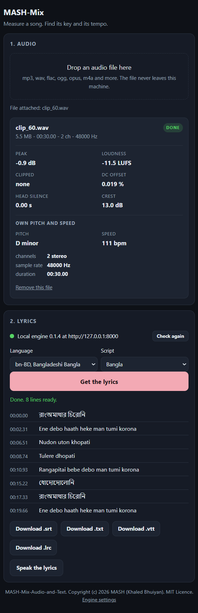
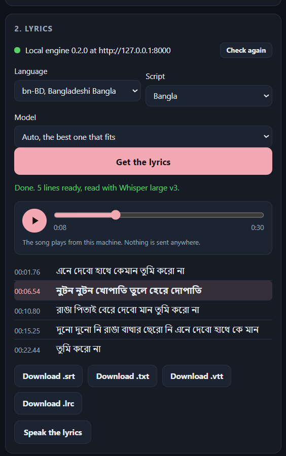
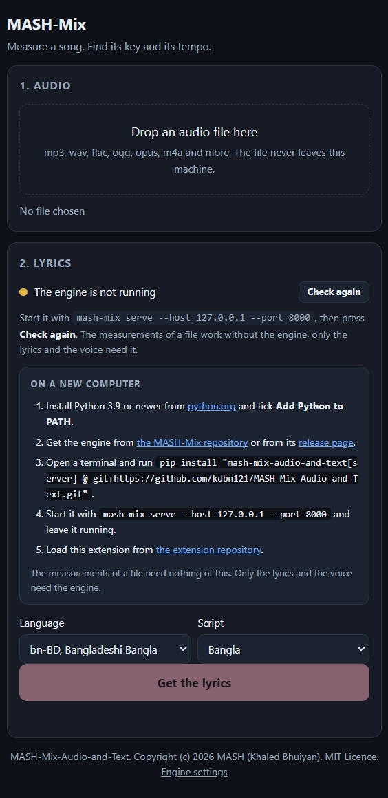
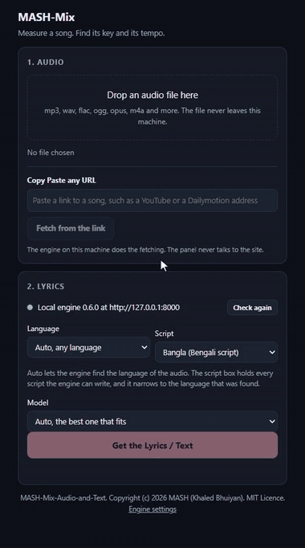

# MASH-Mix-Audio-and-Text, the Chrome extension

The [MASH-Mix-Audio-and-Text](https://github.com/kdbn121/MASH-Mix-Audio-and-Text) engine
as a browser side panel. Drop in a song and the panel measures it: the peak,
the loudness, the clipping, the dc offset, the silence at the head, the crest,
and under **Own pitch and speed** the key of the song and its tempo. With the
local engine running it writes the lyrics as well.

**Nothing you attach leaves your machine.** The measurement happens in the
browser, on your machine. The only thing that is ever sent anywhere is the file
itself, and only when you press **Get the Lyrics / Text**, and only to the engine on
your own machine.

When you paste a link, the address goes to the engine on your own machine and
the engine is the one that visits the site, the way any downloader does. The
audio and the lyrics are written to this machine. Nothing about the song goes
to a vendor.








## The demo

This is the panel doing real work on a real machine: a link is pasted in, the
engine on this machine fetches it and writes the lyrics, the song is moved in
steps of five seconds, a line is corrected in Bangla, the line is cut in two
and the edited file is saved.



The same run as a video, with the sound of nothing and the same frames:
[media/panel-demo.mp4](media/panel-demo.mp4).

The pointer on the screen is drawn into the page for the recording, because a
picture taken by a browser never carries the pointer of the mouse. Every click,
every letter and every button in the demo is the real thing.

## Install

The extension is plain Manifest V3 and it has no build step.

1. Clone or download this repository.
2. Open `chrome://extensions` in Chrome or Edge.
3. Turn on **Developer mode**.
4. Press **Load unpacked** and pick the folder of this repository.
5. Press the MASH-Mix button in the toolbar. The panel opens on the right.

Chrome 114 or newer is needed for the side panel. Edge works the same way.

## What the panel shows

### The file

The name of the file, its size, its length, the number of channels and the
sample rate it was decoded at.

### Copy Paste any URL

Under the drop zone there is a field for a link. Paste the address of a song,
a YouTube video, a Dailymotion page or anything else the engine can read, and
press **Fetch from the link**.

The engine on your machine does the fetching. The panel hands over the address
and nothing else, so the browser never visits the site, and the panel still
cannot reach anything but your own machine.

What comes back is shown in a card above the lyrics:

| What you see | What it means |
|---|---|
| The title | The name the page gave the song |
| The line under it | Who put it there, how long it is and which site it came from |
| The language | The language of the song and how it was worked out |
| The script | The writing system the lyrics are in |
| The words | Where the words came from: the page's own subtitles, or a model that read the audio |

The language is worked out in three steps, and the panel says which one was
used. A page that names its own language is believed. A page that says
nothing is read from the script of its title, for example the Bengali letters
of a Bengali title. When the page says nothing at all, the model is asked what
it hears. A guess is always shown as a guess.

**The words line is the honest one.** When the page carries its own
subtitles, the engine uses them, because a page that publishes its subtitles
has the right words and the right timings and nothing has to be recognised.
The run is then a matter of seconds rather than minutes, and the lyrics are
exact. When the page has no subtitles, the audio is read by a model and the
panel says that instead.

The lyrics of the fetched song are written exactly like the lyrics of an
attached file, and the subtitle files are downloaded the same way. The audio
the engine downloaded is on your machine, so the player plays that copy and
you can follow the words as they are sung.

### The measurements

| Measurement | What it means |
|---|---|
| Peak | The loudest sample of the file, in dBFS |
| Loudness | The integrated loudness, in LUFS, measured with the BS.1770 filter on each channel of the file as it is |
| Clipped | The number of samples that reached full scale. Above zero it is a fault the recording cannot repair afterwards |
| DC offset | How far the signal sits above silence, as a percentage of full scale |
| Head silence | The silence at the start of the file, in seconds |
| Crest | The gap between the peak and the average level, in dB |
| Pitch | The key and the mode of the song, for example D minor |
| Speed | The tempo of the song, in beats a minute |

Every number is computed in the browser from the decoded audio.

### The lyrics

With the engine running, the panel also writes the lyrics of the song, with
the timestamps, and offers the subtitle files to download. It can also speak
the lyrics. The button that starts the work is **Get the Lyrics / Text**,
because what it brings back is the words of the song, not only the lyrics
of a song that has them.

### The player

Under the **Get the Lyrics / Text** button there is a player for the song itself.

| What you see | What it does |
|---|---|
| The round button | Plays the song and pauses it again |
| The bar | Moves with the song and takes it to any moment when you drag it |
| The two times | The moment the song is at and the length of the song |
| The two **5s** buttons | Move the song five seconds forward and five seconds back |

The song plays straight from the file you attached, in the browser, on your
machine. Nothing is sent anywhere to make it play.

**The two five second buttons sit under the bar of the player and over the line
that says the song plays from this machine.** Press one and the song jumps five
seconds at once. Hold it down and it keeps jumping in steps of five seconds
until you let go, which is the quickest way to find the exact moment a line is
sung without aiming at the bar.

**Click a lyric line and the song goes to that line.** The line you clicked is
the moment it starts at, and the line under the playhead is marked while the
song runs, so the words can be followed as they are sung.

### The editor

Under the lyrics there is a third card, **3. Editor**, and it holds the lines
of the song as a list you can change. The editor is the one truth about the
words: the lines the player marks, the text file and the subtitle file are all
written from the same list, so they can never disagree with each other.

| What you see | What it does |
|---|---|
| The number on the left | Picks the line. The line that is being worked on is marked |
| The two times | When the line starts and when it ends. Type over either one |
| The box of words | The words of the line, and they are yours to change |
| **play** | Takes the song to the moment that line starts at |
| **Add a line** | Adds an empty line after the one that is picked |
| **Split** | Cuts the line in two where the caret is in the box of words |
| **Merge** | Joins the line that is picked with the one after it |
| **Remove** | Takes the line that is picked away |
| **Cut**, **Copy**, **Paste** | Move a line from one place to another |
| **TEXT** | The plain text file, written as you type |
| **SRT** | The subtitle file, written as you type |
| **Download the edited .srt** | Saves the subtitle file with your edits in it |
| **Download the edited .txt** | Saves the text file with your edits in it |

**The words are held exactly as they were typed.** Nothing in the editor
rewrites the letters, so a word in Bangla, in Tamil, in Arabic or in Latin is
carried through whole and in the order the keyboard wrote it. The box of words
is a plain text box, which is what lets an input method compose it properly.

**The text and the subtitle file are written at once.** Every change is in the
**TEXT** box and in the **SRT** box before you have looked for it, and the file
you download carries your edits, not the words the engine first wrote.

**A line never ends before it starts.** When you move the start of a line past
its end, the end goes with it and the line keeps the length it had, because a
line that ends before it starts is a broken line and a broken line is not
written to the file.

The subtitle file is written the way a player reads it: the times are
`HH:MM:SS,mmm`, the lines are numbered from one, a blank line separates one
line from the next, and a line with no words in it is left out.

### Choosing the model

The **Model** choice tells the engine which recogniser to reach for.

| The choice | What it means |
|---|---|
| Auto, the best one that fits | The engine picks the model that suits the language and falls back when one cannot be loaded |
| Best quality, the slow one | The strongest model, and the slowest |
| Fast, the quick one | The quick model, for a short clip or a slow computer |

The panel says which model did the work once the lyrics are ready.

### Choosing the language

The **Language** choice is **Auto, any language** by default.

| The choice | What it means |
|---|---|
| Auto, any language | The engine finds the language of the audio on its own, from the page, from the title and from the model |
| bn-BD, bn-IN, bn | Bangla, with the region worked out or forced |
| Any other code | The language is forced. A language other than Bangla keeps the script the recogniser used, because there is nothing to convert it to |

The **Script** choice follows the **Language** choice. It is never a fixed
list, and it never offers a script that the engine cannot write.

| When the language is | The script box holds | And it starts on |
|---|---|---|
| Auto, any language | Every script the engine can write, until the language is found | Bangla, the first of them |
| Bangla, any region | Bangla and Banglish | The native Bangla script |
| Any other language | The script that language is written in, and nothing else | That script |

A language the engine cannot write in a second script is offered in its own
script only. The engine can write Bangla in Bangla or in romanised Bangla,
but it cannot turn Devanagari or Tamil into Latin letters, so those languages
are offered in the script they are written in. An option that does nothing is
worse than no option at all.

When the language is found, the script box narrows to the scripts of that
language, so the box shows what the engine can actually produce for the words
it just wrote. A script chosen by hand is kept when it is still one of them.

**A choice made by hand is remembered for that language.** Pick Banglish for
Bangla, go to another language and come back, and Banglish is still there. A
language you have never touched keeps its own script.

### The outcome of the run

At the foot of the panel there is a card with the result of the run.

| What you see | What it means |
|---|---|
| The title | The name of the song |
| The line under it | The language, the script the words were written in, and the number of lines |
| The text | The lyrics or the text exactly as it was written |
| **Copy to clipboard** | Puts the text on the clipboard with one click |
| **Download .txt** | Saves the text as a readable file, named after the song |

The clipboard is asked for first and the old way of copying is kept as a
second road, so the copy works even where the clipboard of the browser is
not allowed. Neither action needs a permission the extension did not already
have, and the file is written on your own machine.

### While the engine works

Under the line that says what is happening, such as **The engine is fetching
the link and writing the lyrics.**, a bar moves while the engine is busy. A
run that takes minutes is not a frozen panel.

The bar goes away when the work is done or when it failed. The buttons are
held down while it works, because a second run would only fight the first
one. A reader who asks for less movement gets a still bar instead, and the
bar needs no permission the extension did not already have.

### The engine line

The dot under **2. Lyrics** says whether the engine was found.

| The dot | What it means |
|---|---|
| Green | The engine answered. The version and the address it answered on are shown, and the lyrics button is ready |
| Amber | The engine is not running. The measurements still work, only the lyrics and the voice need it |

**Check again** looks for the engine without reloading the panel, which is
what you want after starting the engine in a terminal. When the engine
answers on another port, that address is saved for next time. If the engine
cannot be found, the panel shows the steps for a new computer, and the
settings page has the same guide with a button that tests the engine.

## The engine

The lyrics need a little help: a speech model does not fit in a browser
extension. The engine is the Python package of the same project, and it runs
on your machine.

```bash
mash-mix serve --host 127.0.0.1 --port 8000
```

The panel finds the engine at `http://127.0.0.1:8000` by default. It also
looks on the ports 8000, 8001, 8080 and 8123, so an engine that runs on
another port is usually found without changing anything. The address can be
set by hand in the settings of the extension. The measurements work without
the engine.

## On a new computer

The extension measures a file on its own. The engine is only needed for the
lyrics and the voice, and it needs Python.

**1. Install Python.** Python 3.9 or newer from
[python.org/downloads](https://www.python.org/downloads/). On Windows, tick
**Add Python to PATH** in the installer, otherwise the terminal will not find
it.

**2. Get the engine.** From the
[MASH-Mix-Audio-and-Text repository](https://github.com/kdbn121/MASH-Mix-Audio-and-Text),
clone it, or take the source archive from the
[v0.3.0 release](https://github.com/kdbn121/MASH-Mix-Audio-and-Text/releases/tag/v0.3.0).

**3. Install it.**

```bash
pip install "mash-mix-audio-and-text[server,sources] @ git+https://github.com/kdbn121/MASH-Mix-Audio-and-Text.git"
```

The **sources** extra is the fetcher for links. Without it the panel still measures
files and reads local songs, and only the link stays out of reach.

**4. Start it and leave it running.**

```bash
mash-mix serve --host 127.0.0.1 --port 8000
```

**5. Load the extension.** Unzip the archive of this repository, open
`chrome://extensions`, turn on **Developer mode**, press **Load unpacked** and
pick the folder that holds `manifest.json`.

**6. Check it.** Open the settings of the extension and press **Test the
engine**. It answers with the version when everything is in place. The panel
shows a green dot when the engine is found.

The panel shows the same steps if it cannot find an engine, and the
**Check again** button looks for it again once it is running.

## How the numbers are worked out

The interesting part of this extension is not the panel, it is the analysis
behind it. Two things are worth knowing.

**The key is read from the peaks of the spectrum, not from every bin of it.** A
loud note spreads its energy over the bins around it, and the broadband skirt
of that energy leaks into the pitch classes next door. The harmonic content of
a chord does the same. Count every bin and a C major triad that carries a few
harmonics reads as E minor, and a whole song reads as the wrong key. Count
only the peaks and it reads as C major.

**The beat period is searched in steps of a fraction of a frame.** The beat of
a real track does not land on a whole frame of the analysis grid, and a search
that only looks at whole frames reads the wrong tempo whenever it does not. The
search moves in small steps and folds the onsets onto the beat grid to tell a
beat apart from two beats, so a track that beats at 120 is not reported at 60.

**The frequency of a peak is worked out from the bins around it.** A tone of
220 Hz does not sit on a bin of the transform, it falls between two of them, and
at the bottom of the range a semitone is narrower than a bin. The peak is
therefore fitted with a parabola on the three bins around it, so the key of a
file does not change when the file is at 22050 Hz or at 48000 Hz. Without it a
C major triad read as E minor at 48 kHz.

All three rules are the same ones the Python engine uses, and the two agree on
the same file. The cross check in `tools/check-song.mjs` runs the browser side
on a WAV file and prints the numbers to compare against the engine.

## Development

```bash
node --test tests/     # the analysis and the panel
node tools/audit.mjs   # the static audit of the packaged extension
```

The extension is plain JavaScript with no dependencies and no build step. The
tests run on node, the audit is a static check of the source.

## Privacy

Read [PRIVACY.md](PRIVACY.md). In short: the measurement never leaves the
browser, the only host the extension can reach is the local engine on your
own machine, and there is no analytics anywhere in it.

## Licence

MIT. Copyright (c) 2026 MASH (Khaled Bhuiyan).
